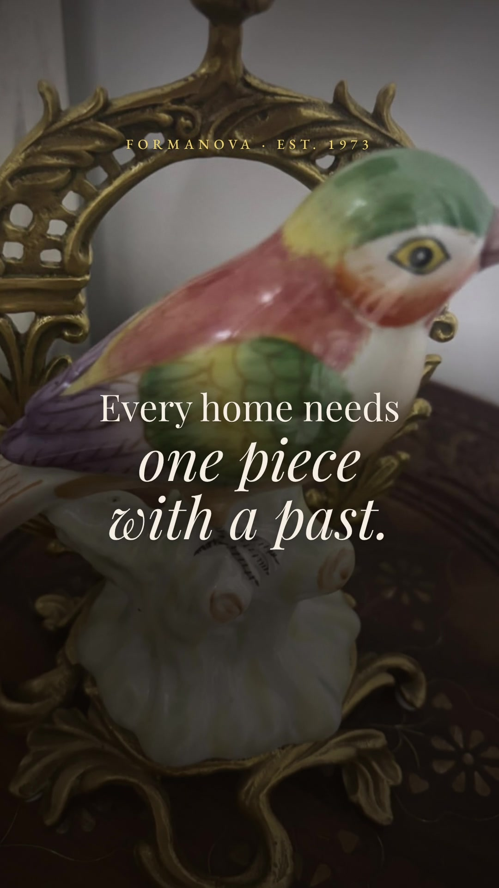
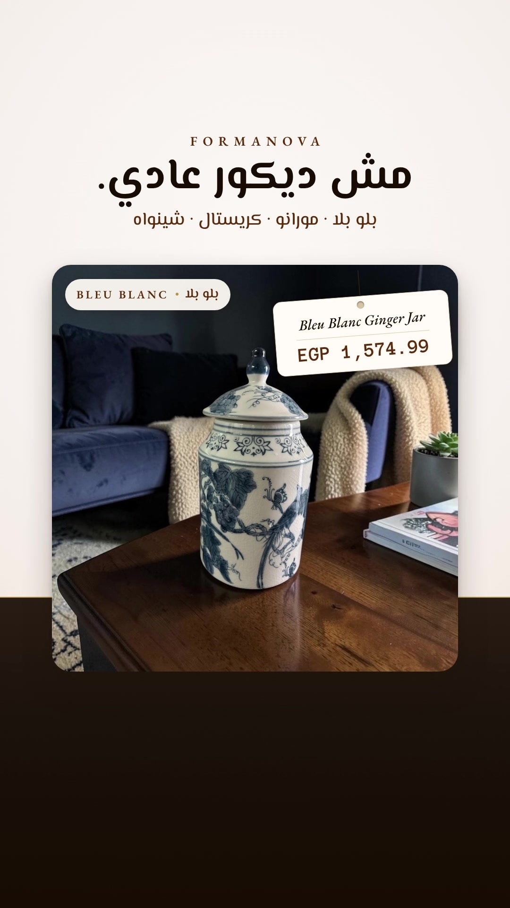

# October 2026 sales launch

Two 15-second vertical advertisements for Instagram and Facebook Reels and Stories in Egypt. They are built as two competing conversion hypotheses: an **emotional heritage film** in English and a **direct-response product film** in Egyptian Arabic.

> **Status, 6 November 2026.** Three featured pieces are no longer on the store: the amber *Murano Glass Vase* (in both films), the *Satsuma Chinoiserie Bonbonnière* and the *Bleu Blanc Porcelain Potiche with Brass-Rimmed Lid* (both in film 02). Before running these films again, swap those pieces in the source and re-render. Pause them while the [Black Friday](../2026-11-black-friday/README.md) sale runs: they show full prices.

<table>
<tr>
<td align="center" width="50%">
<a href="creative-01-heritage/final/formanova-heritage-15s.mp4"></a>
<br><b>01 · One Piece With a Past</b>
<br><sub>Emotional heritage · English</sub>
<br><a href="creative-01-heritage/final/formanova-heritage-15s.mp4">MP4</a> · <a href="creative-01-heritage/script.md">Script</a> · <a href="creative-01-heritage/storyboard.md">Storyboard</a>
</td>
<td align="center" width="50%">
<a href="creative-02-product/final/formanova-product-15s.mp4"></a>
<br><b>02 · Not Your Ordinary Decor</b>
<br><sub>Direct response · Egyptian Arabic</sub>
<br><a href="creative-02-product/final/formanova-product-15s.mp4">MP4</a> · <a href="creative-02-product/script.md">Script</a> · <a href="creative-02-product/storyboard.md">Storyboard</a>
</td>
</tr>
</table>

## In this folder

| File | Contents |
|---|---|
| [strategy.md](strategy.md) | Research findings, audience hypotheses, the two conversion hypotheses, the test plan and the recommendation |
| [ad-copy.md](ad-copy.md) | Ready-to-paste Meta copy (primary text, headlines, description, CTA, UTM URLs), on-screen text, featured products, claims and evidence |
| [licensing.md](licensing.md) | Rights and provenance for photography, wordmark, fonts, music and software |
| [asset-manifest.csv](asset-manifest.csv) | Every asset used: local path, SHA-256, source URL, product, price, availability, usage. Generated by `npm run manifest`. |
| [deliverables.json](deliverables.json) | The declared technical spec that CI validates on every push |
| [qa/safe-zone-check.jpg](qa/safe-zone-check.jpg) | Key frames rendered with the Reels interface overlay |
| `creative-0*/` | Final MP4, cover frame, contact sheet, script and storyboard for each creative |

## Deliverables

Both files were measured with `ffprobe` (see `npm run verify`):

| | 01 · Heritage | 02 · Product |
|---|---|---|
| File | `formanova-heritage-15s.mp4` | `formanova-product-15s.mp4` |
| Video | H.264 High, yuv420p, BT.709 | H.264 High, yuv420p, BT.709 |
| Resolution | 1080 × 1920 (9:16) | 1080 × 1920 (9:16) |
| Frame rate / frames | 30 fps / 450 | 30 fps / 450 |
| Duration (container, video, audio) | 15.000 s | 15.000 s |
| Audio | AAC-LC, 48 kHz stereo, 320 kb/s target | AAC-LC, 48 kHz stereo, 320 kb/s target |
| Loudness | −14.1 LUFS, −1.8 dBTP | −14.1 LUFS, −1.3 dBTP |
| Size | 6.9 MB | 8.2 MB |
| Streaming | `faststart` (index at the front of the file) | `faststart` |

## Quality assurance

| Check | Result |
|---|---|
| Exact duration and frame count | Container, video and audio all 15.000000 s; 450 frames decoded |
| Black frames (`blackdetect`) | None |
| Unintended static or frozen segments (`freezedetect`) | None. The only hold is the final end card (about 1.2–1.4 s), kept for reading time. |
| Silent gaps (`silencedetect`, −50 dB) | None |
| Encode fidelity versus the lossless render | SSIM 0.986, PSNR 41.9 dB (sample frame, Creative 02) |
| Safe zones | All copy inside y 270–1250 px and x 80–1000 px. See [qa/safe-zone-check.jpg](qa/safe-zone-check.jpg). |
| Product accuracy | Original listing photographs only; no recolouring or retouching; every claim traced to its listing (see [ad-copy.md](ad-copy.md)) |
| Availability and prices | All 14 featured products available at the advertised prices on 30 October 2026, 08:05 UTC |
| Destination | `/collections/all-products` returns 200 and lists only in-stock pieces |
| Playback dependencies | None. Fonts, images and audio are embedded or vendored; no external URLs are needed. |
| Reproducibility | Re-rendering from `Content/Production` with `npm run render` reproduces both files byte-for-byte (SHA-256 below). The score generator is also byte-for-byte deterministic. |

**SHA-256 of the delivered files**

```
3247b0421c7434275c293e8ef79007d859236df6e253caf7b57a7ec533abbab1  creative-01-heritage/final/formanova-heritage-15s.mp4
44a0d6c8005ef5861f393fa9c7daba699180943c6a74d4a2d49dbaafcbb892d0  creative-02-product/final/formanova-product-15s.mp4
```

## Launch checklist

1. Re-check stock: `cd Content/Production && npm run check:availability`. Behind a proxy, prefix it with `NODE_USE_ENV_PROXY=1`.
2. Upload both MP4s, ideally as one A/B test with the creative as the only variable (see the [test plan](strategy.md#5-test-plan)).
3. Paste the copy and UTM destination URLs from [ad-copy.md](ad-copy.md).
4. Placements: Instagram and Facebook Reels and Stories.
5. Judge on cost per purchase and ROAS only once there is enough data. Never judge on views or CTR alone.
