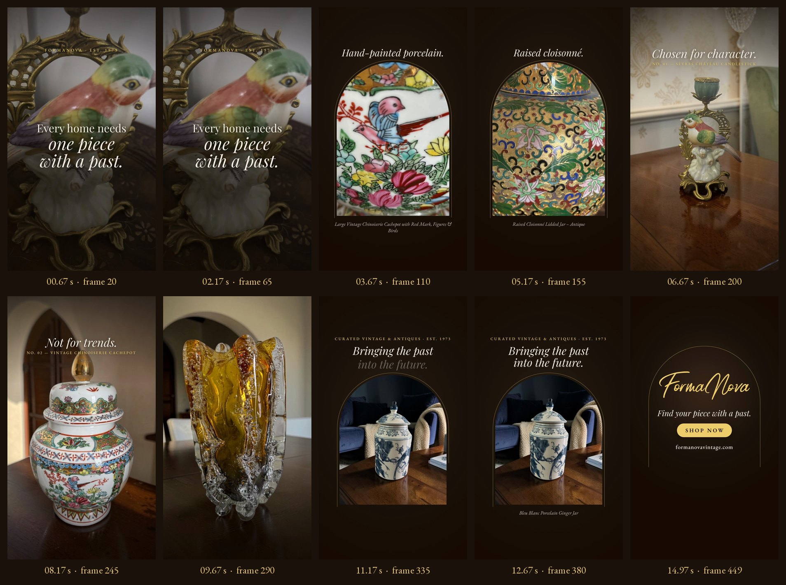

# Storyboard — 01 · One Piece With a Past

*Frames extracted from the final MP4, every 45 frames (1.5 s), plus the last frame.*

## Visual system: "the gallery arch"

The round-headed arch is the recurring device. It echoes the arched windows and doorways in Formanova's own room photography and the niches of a museum vitrine. The film alternates between **inside the arch** (intimate detail) and **through the arch** (the piece at home in a room). That gives a five-beat rhythm: full frame → arch → full frame → arch → end card.

| Element | Specification |
|---|---|
| Palette | Espresso and near-black grounds (#1A110B, #170B02), ivory type (#F6EEE3), wordmark gold (#EFCE6C) |
| Type | Playfair Display Italic for emotional lines; EB Garamond small caps for labels; the original gold script wordmark |
| Texture | Subtle, deterministic film grain (5.5%) and a soft lens vignette |
| Photography | Original listing images, never retouched or recoloured. Only framing, scale and position are animated. |
| Safe area | All copy sits between y 270 and y 1250 px, at least 80 px from the sides (Reels interface clearance). |

## Shot list

| # | Frames | Shot | Source image | Motion and transition |
|---|---|---|---|---|
| 1 | 0–92 | Hook: hand-painted bird, extreme close-up | Sèvres candlestick, listing image 8 (product photo) | Push-in 1.06→1.15 toward the bird's eye. Copy rises in word groups by frame 26. Frames 72–90: the full frame contracts into the arch. |
| 2 | 72–120 | Detail: painted birds and peonies | Chinoiserie cachepot, listing image 10 (product photo) | Revealed inside the arch as shot 1 dissolves. Upward drift. The gold arch outline draws on. |
| 3 | 112–150 | Detail: star-cut crystal | Czech crystal vase, listing image 5 (product photo) | 8-frame cross-dissolve, slow push. |
| 4 | 142–196 | Detail: raised cloisonné | Cloisonné jar, listing image 6 (product photo) | 8-frame cross-dissolve, slow push. |
| 5 | 170–224 | Payoff: the candlestick in its room | Sèvres candlestick, listing image 3 (styled interior) | Fades in inside the arch, then the arch opens to full frame (frames 176–196): "stepping into the room". Lateral drift. |
| 6 | 216–272 | Payoff: cachepot under an arched doorway | Chinoiserie cachepot, listing image 1 (styled interior) | 10-frame cross-dissolve, lateral drift. |
| 7 | 264–336 | Payoff: amber Murano glass in sunlight | Murano glass vase, listing image 2 (styled interior) | Cross-dissolve. Frames 312–330: contracts into the brand arch. |
| 8 | 312–402 | Brand: Bleu Blanc ginger jar | Bleu Blanc ginger jar, listing image 1 (styled interior) | Revealed as shot 7 dissolves. Slow push inside the arch. Copy rises. |
| 9 | 386–450 | End card | FormaNova gold wordmark (original PNG) | The espresso ground fades up. The hairline arch draws on. The wordmark wipes on left to right (frames 389–411). Copy, button and URL rise in sequence and hold from frame 424. |
