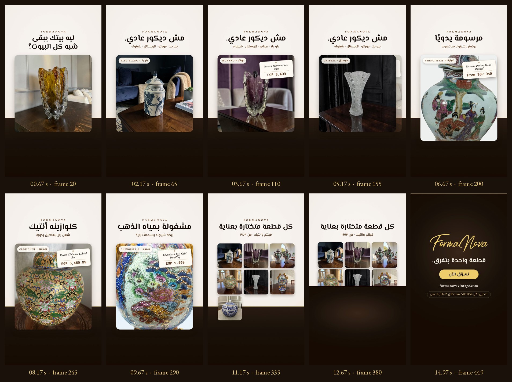

# Storyboard — 02 · Not Your Ordinary Decor

*Frames extracted from the final MP4, every 45 frames (1.5 s), plus the last frame.*

## Visual system: "the display plinth"

A warm ivory upper stage (the storefront's cream, #F7F1ED) sits over an espresso plinth with a gold edge. Product cards stand on the plinth like pieces in a shop window. The darker lower band also keeps the Reels interface (caption, account name, CTA button) legible. Each card carries a bilingual collection chip and a hanging **shop tag**: the product name in EB Garamond italic and the price in Anonymous Pro, the storefront's accent face, which reads like a typewritten label. At the end the plinth rises to become the espresso end card.

| Element | Specification |
|---|---|
| Palette | Cream stage (#F7F1ED → #EFE3D8), espresso plinth (#2A1C13 → #170B02), walnut text (#5D2B09), gold edge and button (#B8913F, #EFCE6C) |
| Type | El Messiri (Arabic headlines, by Egyptian designer Mohamed Gaber); EB Garamond and Anonymous Pro (tags); the original gold wordmark |
| Rhythm | 120 BPM grid: hook flips every eighth note, proof cards every two beats, detail cards every three beats |
| Direction | Right-to-left reading: each new card enters from the left |
| Safe area | All copy, chips and tags sit between y 270 and y 1250 px, at least 80 px from the sides |

## Shot list

| # | Frames | Shot | Source image | Motion |
|---|---|---|---|---|
| 1 | 0–45 | Hook flip-book (6 pieces) | Listing images: egg #1, cobalt centerpiece #2, Murano vase #1, Satsuma bonbonnière #2, Bleu Blanc potiche #2, Bohemian vase #3 | A hard cut every eighth note with a 4.5% scale punch. The headline is on screen from frame 0. |
| 2 | 45–90 | Bleu Blanc ginger jar | Ginger jar #1 | Lands with a punch. Chip at frame 47; tag drops and settles at frames 68–84. |
| 3 | 90–120 | Italian Murano vase | Italian Murano #1 | Deck move: enters from the left, previous card exits right. Tag at frame 98. |
| 4 | 120–150 | Pair of Chinoiserie potiches | Potiches #2 | Deck move. Tag at frame 128. |
| 5 | 150–180 | Czech crystal vase | Crystal #3 | Deck move. Tag at frame 158. |
| 6 | 180–225 | Hand-painted Satsuma detail | Satsuma potiche #5 (product photo) | Taller card, slow push 1.28→1.38. The claim headline swaps in. Tag at frame 190. |
| 7 | 225–270 | Raised cloisonné detail | Cloisonné jar #6 (product photo) | Deck move. Tag at frame 235. |
| 8 | 270–318 | Gilded egg detail | Chinoiserie egg #5 (product photo) | Deck move. Tag at frame 280. Exits as the mosaic begins. |
| 9 | 315–392 | Collection mosaic (9 pieces) | Ginger jar #1, Italian Murano #2, potiches #4, cloisonné #1, crystal #3, egg #1, Bleu Blanc potiche #2, Satsuma potiche #2, Bohemian vase #3 | Tiles pop in two frames apart (frames 321–345), then the grid drifts and each photo slowly zooms. |
| 10 | 375–450 | End card | FormaNova gold wordmark | The plinth rises (frames 375–389). The wordmark wipes on (frames 381–401). Line, button, URL and delivery chip follow in sequence and hold from frame 415. |
