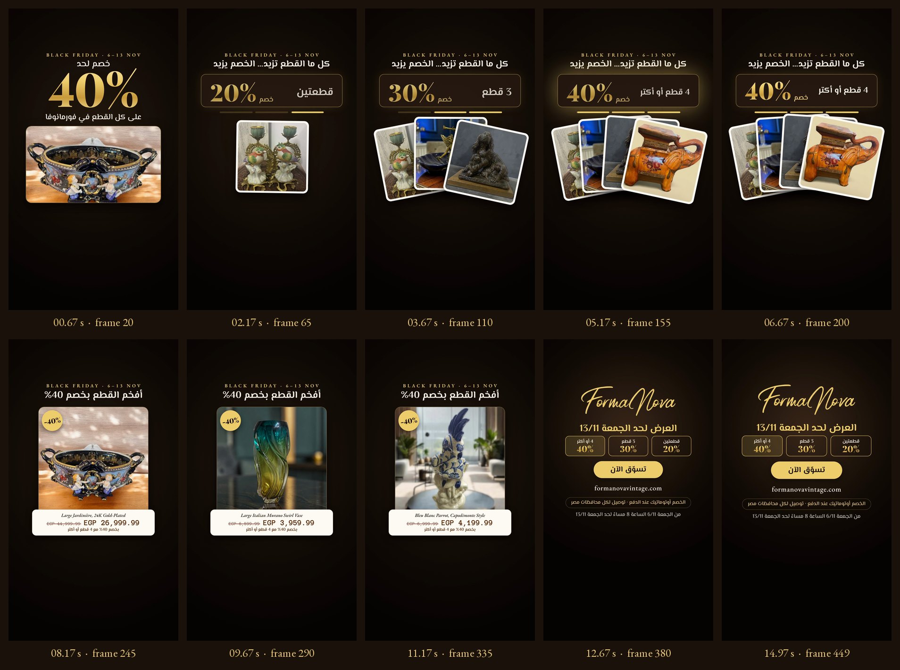

# Storyboard — Black Friday 01 · The Ladder

*Frames extracted from the final MP4, every 1.5 s, plus the last frame.*

## Visual system

A dark espresso stage with gold typography, so the sale reads as Formanova rather than a discount banner. The tier panel and progress bars carry the offer. White-bordered "print" cards fan out like pieces collected on a table. Prices sit on cream panels **below** each photograph, so nothing covers a product.

| Element | Specification |
|---|---|
| Palette | Espresso ground (#24170F → #060403), wordmark gold (#EFCE6C) with a gold gradient on percentages, cream panels (#FFFBF4), walnut prices (#5D2B09) |
| Type | Playfair Display Black (percentages), El Messiri (Arabic), Anonymous Pro (prices), EB Garamond (labels and URL) |
| Rhythm | 120 BPM: tiers on beats at 2.0, 3.5 and 5.0 s; price cards every 1.5 s |
| Reading direction | Right to left: progress bars fill from the right; each new card rises into the right of the fan |
| Safe area | Every line of copy, price and product sits between y 270 and 1250 px, at least 80 px from the sides ([QA sheet](../qa/safe-zone-check.jpg)) |

## Shot list

| # | Frames | Shot | Source image | Motion |
|---|---|---|---|---|
| 1 | 0–60 | Hook: 40% over the jardinère | Jardinère, listing image 4 | The 40% punches in from 116% scale; slow push on the photo; exit 53–60. |
| 2 | 58–105 | Tier 1: two cards | Sèvres pair #5, cobalt centerpiece #1 | The panel fades up; cards rise and fan in on the beat (frames 60 and 65). |
| 3 | 105–150 | Tier 2: three cards | + spelter statue #3 | The old tier leaves on the beat, the new one lands 3 frames later; the fan re-spreads. |
| 4 | 150–216 | Tier 3: four cards | + elephant side table #2 | Gold glow burst on the 40% tier; the whole fan drifts and slowly scales. |
| 5 | 210–255 | Price: jardinère | Jardinère #4 | Card slides in from the left; −40% badge pops; price panel slides up (frame 218); strike draws through the regular price. |
| 6 | 255–300 | Price: Murano swirl vase | Murano swirl vase #1 | Same sequence; panel at frame 263. |
| 7 | 300–345 | Price: Bleu Blanc parrot | Parrot #1 | Same sequence; panel at frame 308. |
| 8 | 340–450 | End card | FormaNova wordmark | Fade up; wordmark wipes on (frames 342–358); copy and pills build by frame 380; slow 3% push to the end. |
