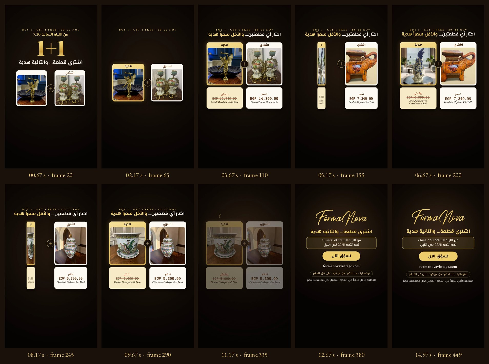

# Storyboard — Buy 1 Get 1 01 · 1+1, Tonight

*Frames extracted from the final MP4, every 1.5 s, plus the last frame.*

## Visual system

Two cream cards stand side by side like gallery labels: the piece you buy in white under «اشتري», the gift in gold under «هدية». A gold "+" sits between them. The cards flip, like turning over a price tag, to reveal each new pair on a downbeat.

| Element | Specification |
|---|---|
| Palette | Espresso ground, ivory type (#F6EEE3), wordmark gold (#EFCE6C) with a gold gradient on "1+1", cream cards and panels (#FFFBF4), gold gift card and pale-gold gift panel (#F9EDC8), strike red (#A3341F) |
| Type | El Messiri (Arabic), Playfair Display Black ("1+1", "+"), EB Garamond (ribbon, product names, URL), Anonymous Pro (prices) |
| Rhythm | 120 BPM: a new pair every 3 s on a downbeat; the free price is struck 1 s after each flip |
| Safe area | Every card, label and price sits between y 270 and 1250 px ([QA sheet](../qa/safe-zone-check.jpg)) |
| Products | Never covered: "buy" and "gift" sit on a strip above each photograph, prices on panels below |

## Shot list

| # | Frames | Shot | Source image | Motion |
|---|---|---|---|---|
| 1 | 0–60 | Hook | Sèvres pair #5, cobalt centerpiece #1 | "1+1" settles from 116% scale and keeps a slow 5% push; cards slide in from the sides (frames 0–15); the gift card turns gold at frame 30. |
| 2 | 58–150 | Pair 1 | Sèvres pair #5, cobalt centerpiece #1 | Cards grow into the pair layout (frames 58–76); panels rise (76–92); strike at frame 90. |
| 3 | 143–240 | Pair 2 | Elephant side table #2, Bleu Blanc parrot #1 | Flip centred on frame 150 (gift: 154); strike at frame 180. |
| 4 | 233–330 | Pair 3 | Chinoiserie cachepot #1, Canton cachepot #3 | Flip centred on frame 240 (gift: 244); strike at frame 270; the scene fades out by frame 340. |
| 5 | 330–450 | End card | FormaNova wordmark | Fade up; wordmark wipes on; copy, date box, button, URL and fine print build by frame 368; slow push to the end. |

Every photograph moves continuously (a slow 10% pull-out per pair), and the whole scene pushes in by 3%, so no frame is static.
