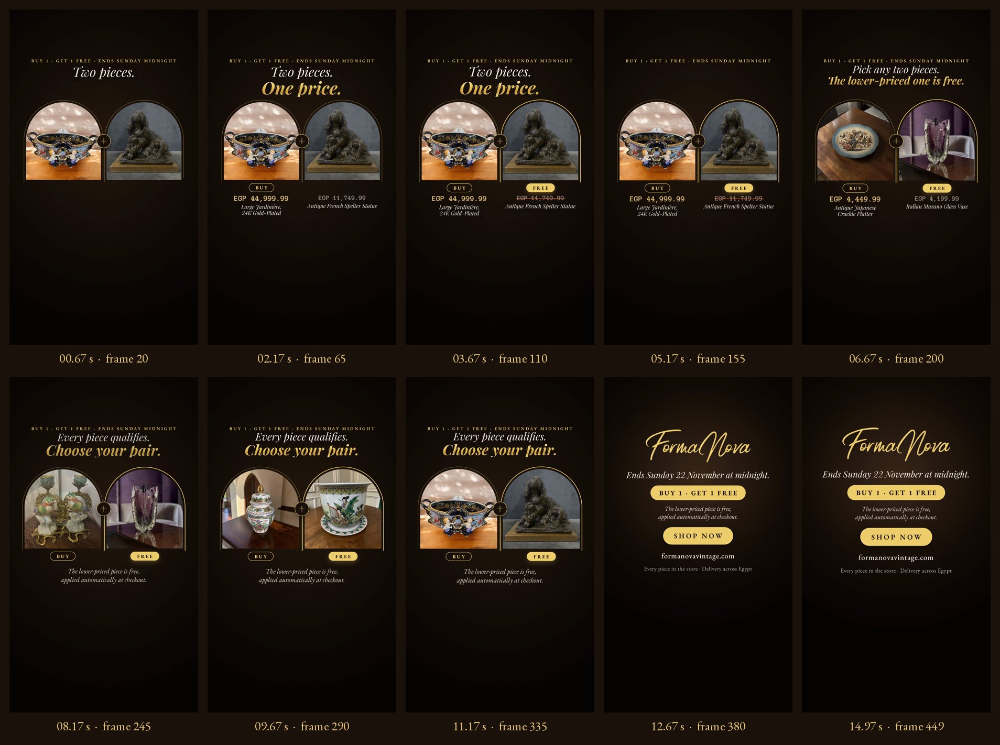

# Storyboard — Buy 1 Get 1 02 · Two Pieces, One Price

*Frames extracted from the final MP4, every 1.5 s, plus the last frame.*

## Visual system

The gallery arch from the brand's earlier films, doubled: two niches side by side, the piece you buy on the left and the free piece on the right. A gold outlined BUY pill and a solid gold FREE pill sit beneath them; once a piece is free, its arch outline thickens and glows.

| Element | Specification |
|---|---|
| Palette | Espresso ground, ivory type (#F6EEE3), wordmark gold (#EFCE6C) with a gold gradient on the second headline line, struck prices in muted ivory with a red rule (#D9573A) |
| Type | Playfair Display Italic (headlines and names), Playfair Display Black (the "+"), EB Garamond (ribbon, pills, rule, CTA), Anonymous Pro (prices) |
| Rhythm | 90 BPM: headline beats at 0 and 0.67 s, FREE at 2.67 s and 6.67 s, a new pair on every beat in the montage |
| Safe area | Arches, labels and copy sit between y 270 and 1250 px and x 80 and 1000 px ([QA sheet](../qa/safe-zone-check.jpg)) |

## Shot list

| # | Frames | Shot | Source image | Motion |
|---|---|---|---|---|
| 1 | 0–160 | Hook and pair 1 | Jardinère #4, spelter statue #3 | Arches settle upward (frames 0–16, the right one from slightly lower); outlines draw on; labels at frame 40; FREE and strike at frame 80; slow 6% push in each arch. |
| 2 | 160–240 | Pair 2 | Japanese crackle platter #1, Italian Murano vase #1 | 8-frame cross-dissolve (right arch 3 frames later); labels swap at frames 152–170; strike at frame 200. |
| 3 | 240–340 | Montage | Sèvres pair #5 + cobalt centerpiece #1; elephant side table #2 + Bleu Blanc parrot #1; chinoiserie cachepot #1 + Canton cachepot #3; jardinère #4 + spelter statue #3 | A cross-dissolve on every beat (frames 240, 260, 280, 300); price labels give way to the rule line; the scene fades out by frame 350. |
| 4 | 340–450 | End card | FormaNova wordmark | Fade up; wordmark wipes on; deadline, pill, rule, button, URL and footer build by frame 378; slow push to the end. |

The whole gallery pushes in by 3% across the film, so no frame is static.
