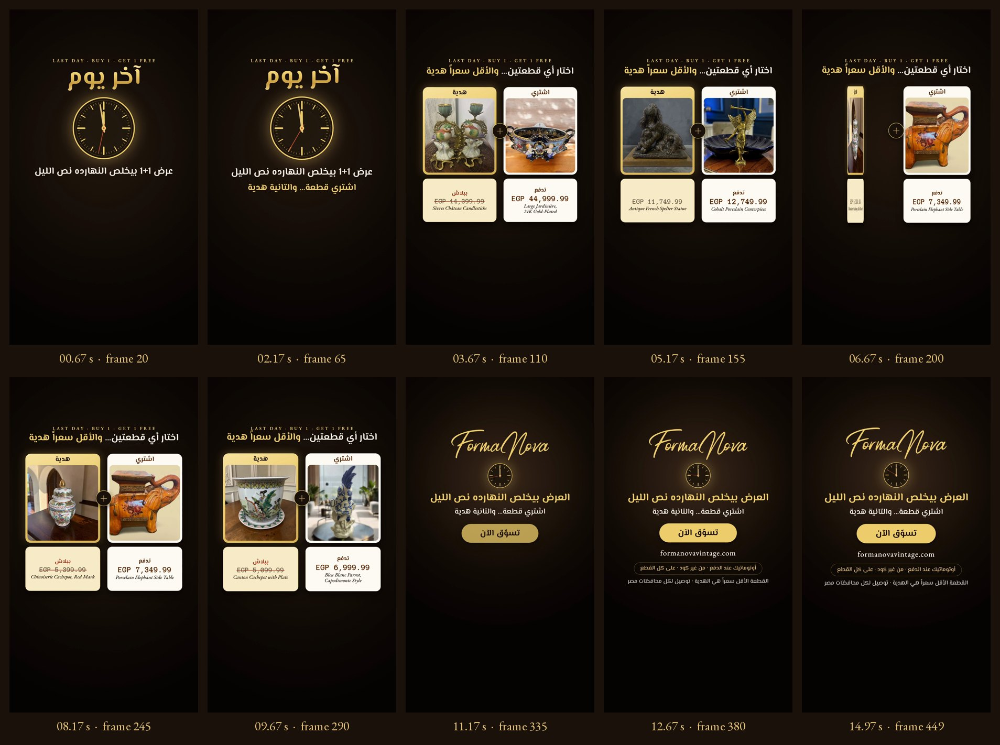

# Storyboard — Buy 1 Get 1 03 · Last Day

*Frames extracted from the final MP4, every 1.5 s, plus the last frame.*

## Visual system

Friday's cards return (the piece you buy in white under «اشتري», the gift in gold under «هدية»), now framed by a clock. A gold dial with sixty ticks, a gold hour and minute hand just short of twelve, and a red second hand that ticks on every beat open the film and return, smaller, on the end card.

| Element | Specification |
|---|---|
| Palette | Espresso ground, ivory type (#F6EEE3), wordmark gold (#EFCE6C) with a gold gradient on «آخر يوم», cream and gold cards, red second hand and strike (#D9573A, #A3341F) |
| Type | El Messiri (Arabic), Playfair Display Black (the "+"), EB Garamond (ribbon, product names, URL), Anonymous Pro (prices) |
| Rhythm | 120 BPM: a clock tick sounds on every beat until 10.5 s; a new pair every 2 s on a downbeat; each free price is struck 1 s after its flip |
| Safe area | Clock, cards, labels and prices sit between y 270 and 1250 px ([QA sheet](../qa/safe-zone-check.jpg)) |
| Products | Never covered: labels sit on a strip above each photograph, prices on panels below |

## Shot list

| # | Frames | Shot | Source image | Motion |
|---|---|---|---|---|
| 1 | 0–78 | Hook | — | «آخر يوم» settles from 114%; the clock scales up from 90%; its second hand ticks every 15 frames; the lines rise in at frames 6 and 30; slow 4% push; fades out at frames 66–78. |
| 2 | 75–135 | Pair 1 | Jardinère #4, Sèvres pair #5 | Cards slide in from the sides (frames 75–91); panels rise (81–97); strike at frame 105. |
| 3 | 128–195 | Pair 2 | Cobalt centerpiece #1, spelter statue #3 | Flip centred on frame 135 (gift: 139); strike at frame 165. |
| 4 | 188–255 | Pair 3 | Elephant side table #2, chinoiserie cachepot #1 | Flip centred on frame 195; strike at frame 225. |
| 5 | 248–326 | Pair 4 | Bleu Blanc parrot #1, Canton cachepot #3 | Flip centred on frame 255; strike at frame 285; fades out at frames 312–326. |
| 6 | 315–450 | End card | FormaNova wordmark, clock | Fade up; wordmark wipes on; the small clock ticks; copy, button, URL and fine print build by frame 355; slow push to the end. |

Every photograph moves continuously and the scene pushes in by 3%, so no frame is static.
