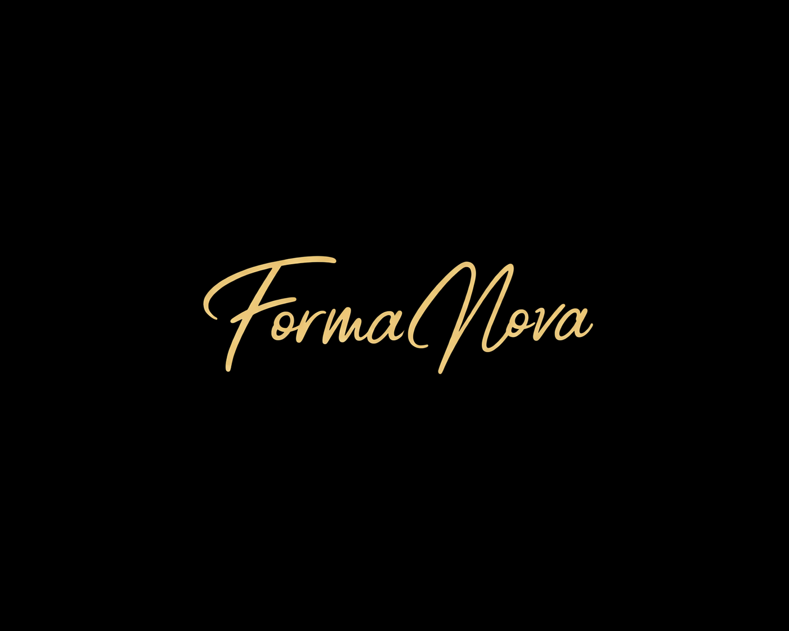

# Formanova brand guidelines

A working reference for anyone creating Formanova content. It is derived from the live storefront (theme settings, fonts, copy), the brand's About page and Instagram profile, as checked on 30 October 2026. Where a rule is an inference rather than a documented brand decision, it says so.

---

## 1. Essence

> *"Formanova is a vintage and antiques concept that traces back to 1973. What once began as a passion for timeless objects is now being reintroduced through a modern and carefully curated experience."*
> — About Formanova

| | |
|---|---|
| **Promise** | Rarity in a world of mass production, depth in a fast world, timelessness in a trend-driven one |
| **Taglines in use** | "Bringing the past into the future" (Instagram) · "Timeless Treasures" · "Curated Collectibles" |
| **Heritage marker** | EST. 1973 (Instagram bio). This is the brand's heritage, not the age of individual pieces. |
| **Signature collections** | Bleu Blanc, Chinoiserie, Murano, Crystal, Cloisonné, Porcelain |
| **Personality** | Knowledgeable, warm, unhurried; a trusted dealer, not a discount store |

## 2. Logo

- **Master files:** [`assets/formanova-logo-gold.png`](assets/formanova-logo-gold.png) (1080 × 1080 transparent PNG; the glyphs occupy x 14–1062, y 374–704) and [`assets/formanova-social-card.png`](assets/formanova-social-card.png) (gold on black, 1402 × 1122).
- **Grounds.** Use the gold script on black, espresso or deep warm grey, as the storefront header does. On cream or white backgrounds the gold loses contrast; switch to a dark band or end card instead.
- **Don't.** Recolour, outline, stretch, add effects (glows, bevels, particles) or retype the wordmark.
- **Clear space.** Keep at least the height of the "F" clear on every side.
- **Minimum width.** 320 px in 1080-wide video and 120 px on the web.

## 3. Colour

The values are sampled from the storefront theme and the wordmark.

| Name | Hex | RGB | Source and use |
|---|---|---|---|
| Ink | `#170B02` | 23 11 2 | Theme foreground. Deepest ground, end cards. |
| Espresso | `#1A110B` | 26 17 11 | Video backgrounds (a warm step from Ink) |
| Walnut | `#5D2B09` | 93 43 9 | Storefront *Add to cart* and *Buy it now* buttons. Text on light grounds. |
| Copper | `#D78650` | 215 134 80 | Storefront accent. Use sparingly. |
| Wordmark gold | `#EFCE6C` | 239 206 108 | Average of the wordmark. CTAs and accents on dark grounds. |
| Antique gold | `#B8913F` | 184 145 63 | Rules and edges on light grounds (video system) |
| Cream | `#F7F1ED` | 247 241 237 | Theme light surface. Light stages. |
| Parchment | `#E7D6CA` | 231 214 202 | Theme secondary surface |
| Peach | `#F2D3B5` | 242 211 181 | Theme accent surface |

## 4. Typography

| Role | Typeface | Notes |
|---|---|---|
| Headings | **Playfair Display** | Storefront heading font. Italic for emotional lines. |
| Body and labels | **EB Garamond** | Storefront body font. Small caps with wide tracking for labels. |
| Accent | **Anonymous Pro** | Storefront accent font. Ideal for prices and "typed" details. |
| Sub-headings (web) | Merriweather | Used by the storefront theme |
| Arabic | **El Messiri** | Recommended for video and social (OFL, by Egyptian designer Mohamed Gaber). Pairs well with Playfair. |

All of these are open-source (SIL OFL 1.1). The video-ready files are in `Content/Production/assets/fonts`.

## 5. Photography

- **Two kinds of image exist on every listing.** First, *styled interior* shots: square, about 1600 px, the piece on warm wood in a classic room; many appear digitally styled. Second, *product photographs*: portrait close-ups of the real piece, often on a carved table, including marks and details. Use interiors for mood and product photographs for any claim about craftsmanship or condition.
- **Never alter the product.** Don't recolour, retouch, AI-upscale, AI-extend or regenerate product imagery. Cropping, framing, motion and type are fine.
- **Check for watermarks.** Two Bleu Blanc ginger jar listing images (5 and 6) carry a visible AI-tool mark. Inspect corners before using any image.
- **Resolution for 9:16 video.** Prefer the 1600 px sources. A full-frame crop of a 1600 px square needs about a 1.2× upscale, which is acceptable. Use smaller sources inside arches or cards rather than full frame.

## 6. Voice

**English.** Calm, assured, editorial. Short declarative lines with room to breathe.

> *Every home needs one piece with a past.* · *Chosen for character. Not for trends.* · *Bringing the past into the future.*

Avoid hype, exclamation marks, superlatives ("best", "cheapest") and generic luxury clichés.

**Egyptian Arabic.** Warm, direct, conversational, and natural rather than translated. Prefer statements to gendered imperatives in headlines (اطلب / اطلبي). Use standard UI phrases such as «تسوّق الآن» for buttons.

**Brand vocabulary** (taken from Formanova's own Arabic product copy):

| Arabic | Meaning |
|---|---|
| بلو بلا | Bleu Blanc |
| شينواه | Chinoiserie |
| كلوازينه | Cloisonné |
| بوتيش | Potiche (lidded jar) |
| فينتج · أنتيك | Vintage · antique |
| حفر يدوي | Hand-cut (crystal) |
| مرسومة يدويًا · هاند بينتد | Hand-painted |
| مياه الذهب | Gold detailing (gold wash) |
| بونبنيرة | Bonbonnière |

## 7. Verified facts and claims policy

**You can say** (verified on the site, 30 October 2026):

- Curated vintage and antiques; the concept traces back to 1973 ("Est. 1973").
- Delivery to all governorates in Egypt: 3–4 working days in Cairo, 4–5 elsewhere (so "3–5 working days" nationally).
- Payment by Instapay, or cash on delivery *where available*. Always keep the qualifier.
- Exchanges within 7 days. Refunds for defective or damaged items reported within 48 hours.
- Enquiries answered within 24 hours. WhatsApp +20 100 658 0682 and Instagram @formanova.vintage.
- Product facts exactly as written on each listing: material, origin, technique, size, condition.

**Never say** without new evidence:

- Scarcity or urgency ("only one left", "selling fast"), demand, bestseller status, reviews.
- Discounts or "sale" pricing that the store doesn't show.
- Authentication ("certified", "original Sèvres"). Use product names as listed.
- Origins not stated on the listing. The amber "Murano Glass Vase" is "Murano glass style" only; the "Italian Murano Glass Vase" states Italy.
- That pieces date from 1973.

## 8. Motion principles (paid social)

- **First frame.** A striking real piece, never a black frame or a logo-only opening.
- **Arches and plinths.** The round-headed arch (from the brand's own interiors) frames heritage stories. An ivory stage over an espresso plinth frames product-led stories.
- **Pacing.** Emotional pieces breathe (about 1 s per detail, 1.5–2 s per room). Direct-response pieces move on the beat (about 1 s per product).
- **Safe zones (1080 × 1920).** Keep copy and key product details between y 270 and y 1250 px and at least 80 px from the sides.
- **Sound.** Every message must read with the sound off. Use original or licensed audio only.
- **End card.** The gold wordmark on espresso, a clear action, the URL, and hold it for at least 1 second.
