<div align="center">

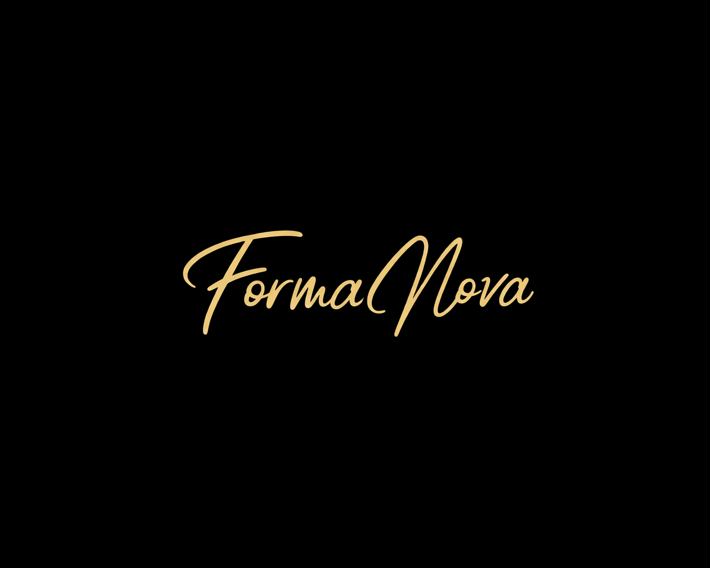

#### CURATED VINTAGE &amp; ANTIQUES · EST. 1973

*Bringing the past into the future.*

[formanovavintage.com](https://www.formanovavintage.com/) &nbsp;·&nbsp; [Instagram @formanova.vintage](https://www.instagram.com/formanova.vintage/)

</div>

---

Formanova is a vintage and antiques house whose story traces back to 1973. It selects pieces one by one for character rather than trend: hand-painted Bleu Blanc and Chinoiserie porcelain, Murano glass, Czech and Bohemian crystal, cloisonné, and the rare objects that give a room its presence. These are pieces made to be kept, reintroduced for modern homes across Egypt.

This repository is the brand's content studio: campaigns, brand standards and the source that produces them.

## Featured work

### 40% off everything: Fri 27 Nov, 8 PM → Sun 29 Nov, 11:59 PM

<table>
<tr>
<td align="center" width="25%" valign="top">
<a href="Content/Ads/2026-11-weekend-40/creative-00-teaser/final/formanova-w40-teaser-15s.mp4">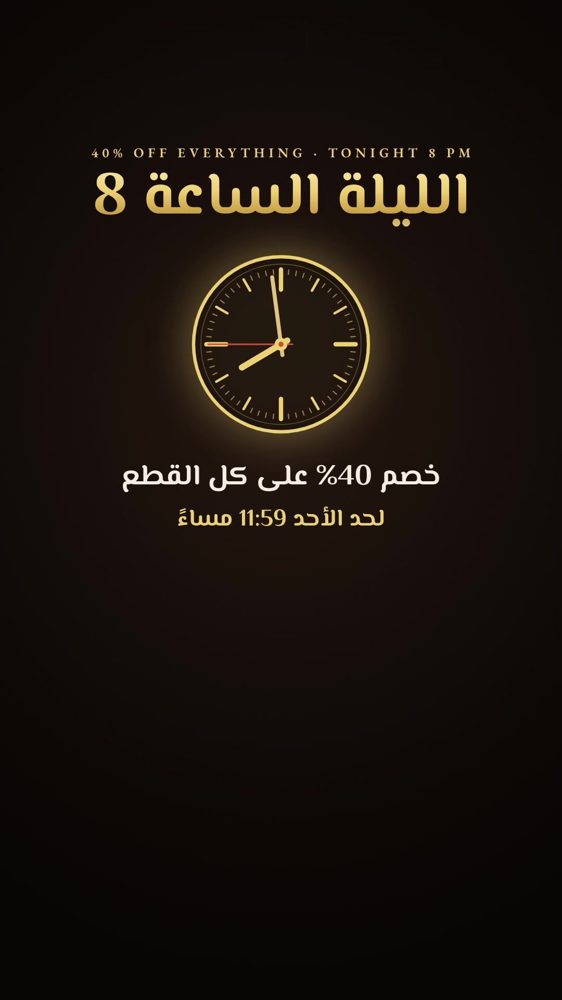</a>
<br><b>00 · Teaser</b>
<br><sub>Organic only · Fri before 8 PM · Arabic</sub>
<br><a href="Content/Ads/2026-11-weekend-40/creative-00-teaser/final/formanova-w40-teaser-15s.mp4">MP4</a>
</td>
<td align="center" width="25%" valign="top">
<a href="Content/Ads/2026-11-weekend-40/creative-01-friday/final/formanova-w40-friday-15s.mp4">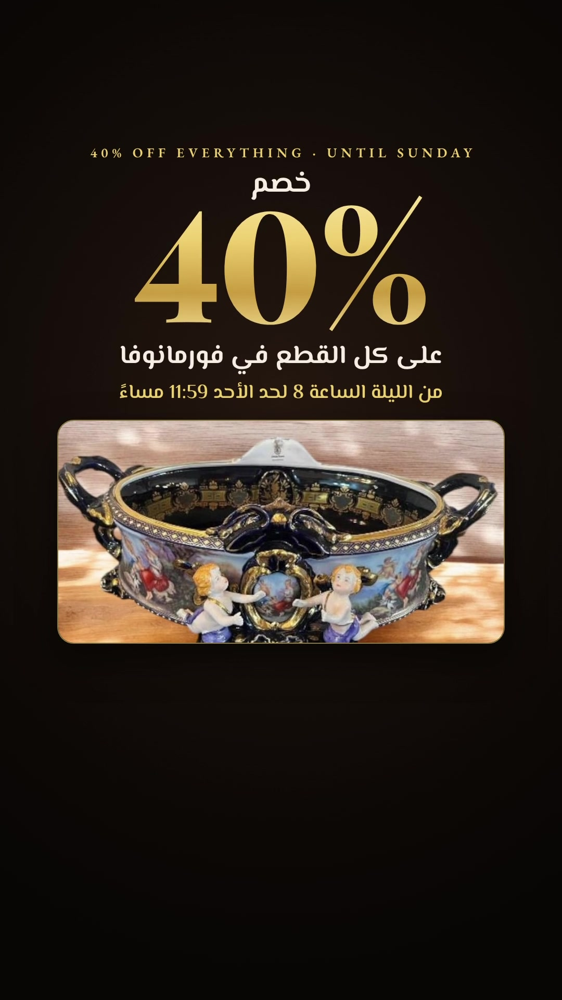</a>
<br><b>01 · Friday</b>
<br><sub>Ad · Fri 7:30–11:59 PM · Arabic</sub>
<br><a href="Content/Ads/2026-11-weekend-40/creative-01-friday/final/formanova-w40-friday-15s.mp4">MP4</a>
</td>
<td align="center" width="25%" valign="top">
<a href="Content/Ads/2026-11-weekend-40/creative-02-sat-a/final/formanova-w40-sat-a-15s.mp4">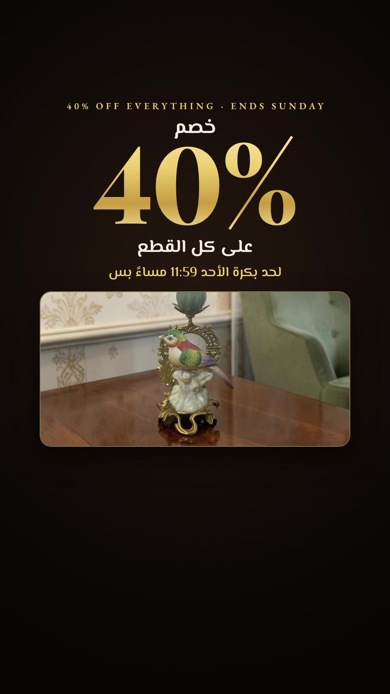</a>
<br><b>02 · Saturday A</b>
<br><sub>Ad · Saturday · Arabic</sub>
<br><a href="Content/Ads/2026-11-weekend-40/creative-02-sat-a/final/formanova-w40-sat-a-15s.mp4">MP4</a>
</td>
<td align="center" width="25%" valign="top">
<a href="Content/Ads/2026-11-weekend-40/creative-03-sat-b/final/formanova-w40-sat-b-15s.mp4">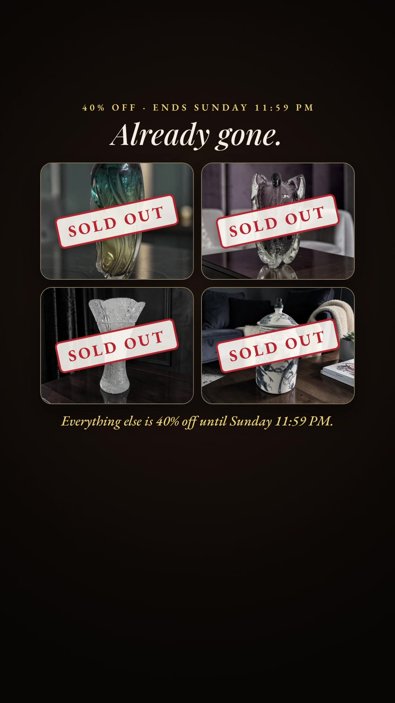</a>
<br><b>03 · Saturday B</b>
<br><sub>Ad · Saturday · English</sub>
<br><a href="Content/Ads/2026-11-weekend-40/creative-03-sat-b/final/formanova-w40-sat-b-15s.mp4">MP4</a>
</td>
</tr>
<tr>
<td align="center" width="25%" valign="top">
<a href="Content/Ads/2026-11-weekend-40/creative-04-sat-c/final/formanova-w40-sat-c-15s.mp4">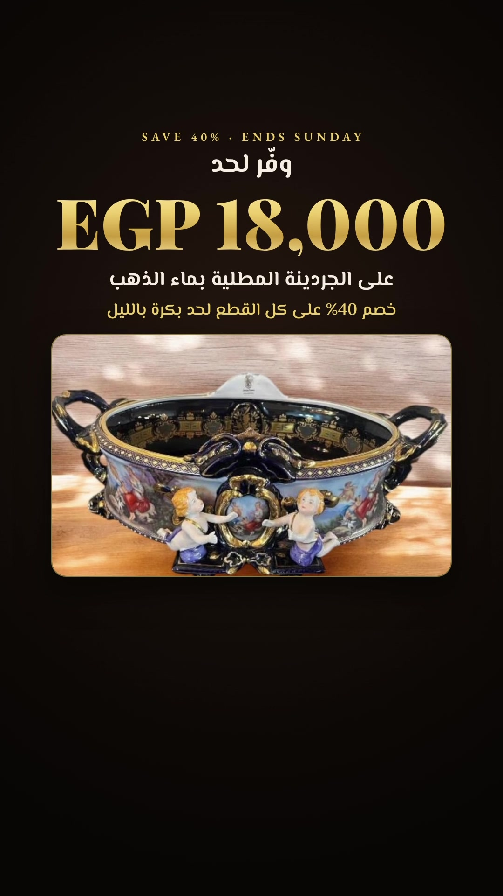</a>
<br><b>04 · Saturday C</b>
<br><sub>Ad · Saturday · Arabic</sub>
<br><a href="Content/Ads/2026-11-weekend-40/creative-04-sat-c/final/formanova-w40-sat-c-15s.mp4">MP4</a>
</td>
<td align="center" width="25%" valign="top">
<a href="Content/Ads/2026-11-weekend-40/creative-05-sun-a/final/formanova-w40-sun-a-15s.mp4">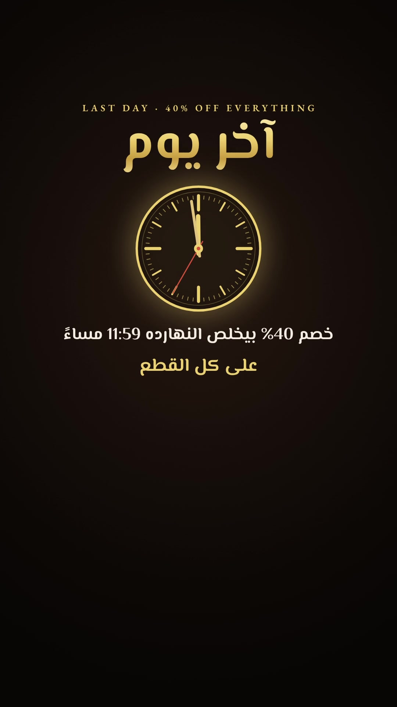</a>
<br><b>05 · Sunday A</b>
<br><sub>Ad · Sunday · Arabic</sub>
<br><a href="Content/Ads/2026-11-weekend-40/creative-05-sun-a/final/formanova-w40-sun-a-15s.mp4">MP4</a>
</td>
<td align="center" width="25%" valign="top">
<a href="Content/Ads/2026-11-weekend-40/creative-06-sun-b/final/formanova-w40-sun-b-15s.mp4">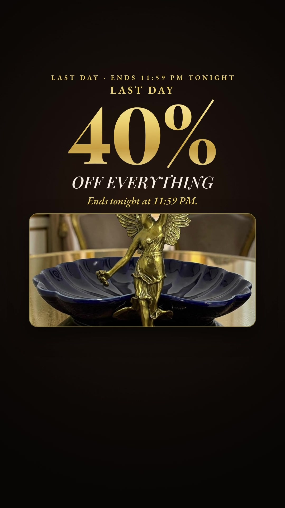</a>
<br><b>06 · Sunday B</b>
<br><sub>Ad · Sunday · English</sub>
<br><a href="Content/Ads/2026-11-weekend-40/creative-06-sun-b/final/formanova-w40-sun-b-15s.mp4">MP4</a>
</td>
<td align="center" width="25%" valign="top">
<a href="Content/Ads/2026-11-weekend-40/creative-07-sun-c/final/formanova-w40-sun-c-15s.mp4">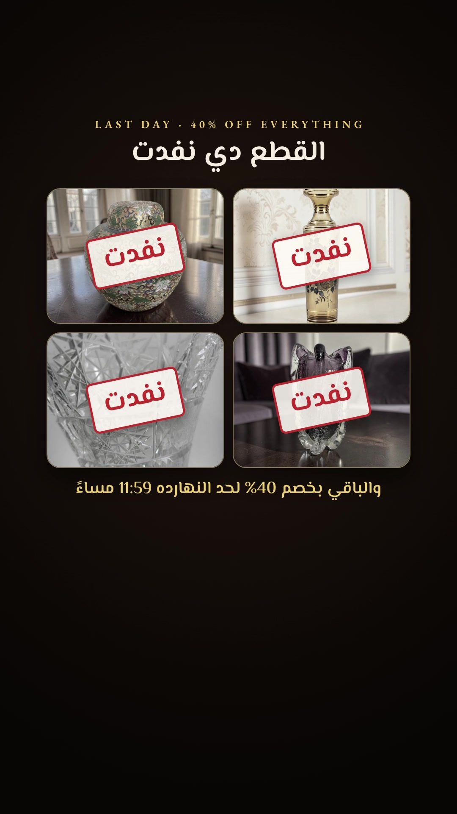</a>
<br><b>07 · Sunday C</b>
<br><sub>Ad · Sunday · Arabic</sub>
<br><a href="Content/Ads/2026-11-weekend-40/creative-07-sun-c/final/formanova-w40-sun-c-15s.mp4">MP4</a>
</td>
</tr>
</table>

Eight 15-second films (an organic teaser and seven urgency ads, one for Friday night and three each for Saturday and Sunday) with the Meta campaign that runs them. See the [campaign overview](Content/Ads/2026-11-weekend-40/README.md) and the [ad copy and captions](Content/Ads/2026-11-weekend-40/ad-copy.md).

### Buy 1 Get 1 Free weekend: Fri 20 Nov, 7:30 PM → Sun 22 Nov, midnight · the lower-priced piece is free

<table>
<tr>
<td align="center" width="33%" valign="top">
<a href="Content/Ads/2026-11-bogo-weekend/creative-01-tonight/final/formanova-bogo-tonight-15s.mp4">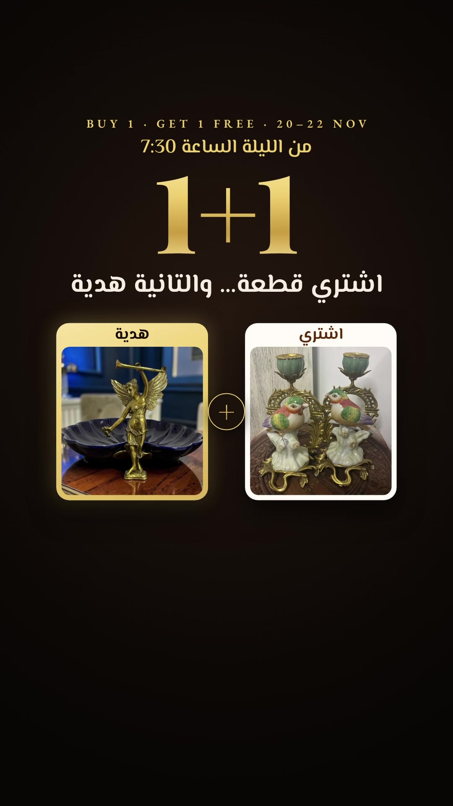</a>
<h4>01 · 1+1, Tonight</h4>
<sub>Friday launch · Egyptian Arabic</sub>
<br><br>
<a href="Content/Ads/2026-11-bogo-weekend/creative-01-tonight/final/formanova-bogo-tonight-15s.mp4"><b>Watch / download MP4</b></a>
<br>
<a href="Content/Ads/2026-11-bogo-weekend/creative-01-tonight/script.md">Script</a> · <a href="Content/Ads/2026-11-bogo-weekend/creative-01-tonight/storyboard.md">Storyboard</a>
</td>
<td align="center" width="33%" valign="top">
<a href="Content/Ads/2026-11-bogo-weekend/creative-02-pair/final/formanova-bogo-pair-15s.mp4">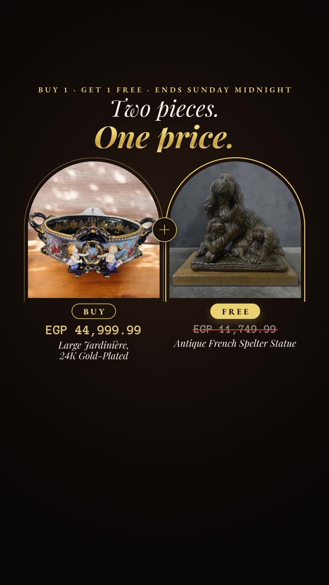</a>
<h4>02 · Two Pieces, One Price</h4>
<sub>Saturday · English</sub>
<br><br>
<a href="Content/Ads/2026-11-bogo-weekend/creative-02-pair/final/formanova-bogo-pair-15s.mp4"><b>Watch / download MP4</b></a>
<br>
<a href="Content/Ads/2026-11-bogo-weekend/creative-02-pair/script.md">Script</a> · <a href="Content/Ads/2026-11-bogo-weekend/creative-02-pair/storyboard.md">Storyboard</a>
</td>
<td align="center" width="33%" valign="top">
<a href="Content/Ads/2026-11-bogo-weekend/creative-03-last-day/final/formanova-bogo-last-day-15s.mp4">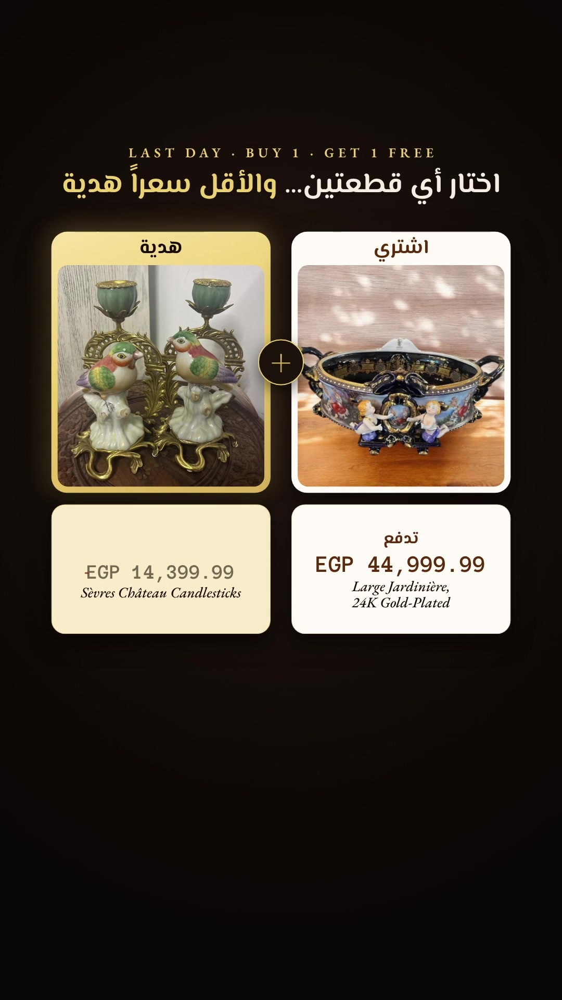</a>
<h4>03 · Last Day</h4>
<sub>Sunday · Egyptian Arabic</sub>
<br><br>
<a href="Content/Ads/2026-11-bogo-weekend/creative-03-last-day/final/formanova-bogo-last-day-15s.mp4"><b>Watch / download MP4</b></a>
<br>
<a href="Content/Ads/2026-11-bogo-weekend/creative-03-last-day/script.md">Script</a> · <a href="Content/Ads/2026-11-bogo-weekend/creative-03-last-day/storyboard.md">Storyboard</a>
</td>
</tr>
</table>

One film for each day of the offer, built from nine pieces in stock with their real prices: the piece you buy, and the lower-priced piece you get free. See the [strategy and launch plan](Content/Ads/2026-11-bogo-weekend/strategy.md), the [ad copy and captions](Content/Ads/2026-11-bogo-weekend/ad-copy.md) and the [campaign overview](Content/Ads/2026-11-bogo-weekend/README.md).

### Black Friday 2026: Fri 6 Nov, 8 PM → Fri 13 Nov · Buy 2 · 20% · Buy 3 · 30% · Buy 4+ · 40%

<table>
<tr>
<td align="center" width="50%" valign="top">
<a href="Content/Ads/2026-11-black-friday/creative-01-ladder/final/formanova-bf-ladder-15s.mp4">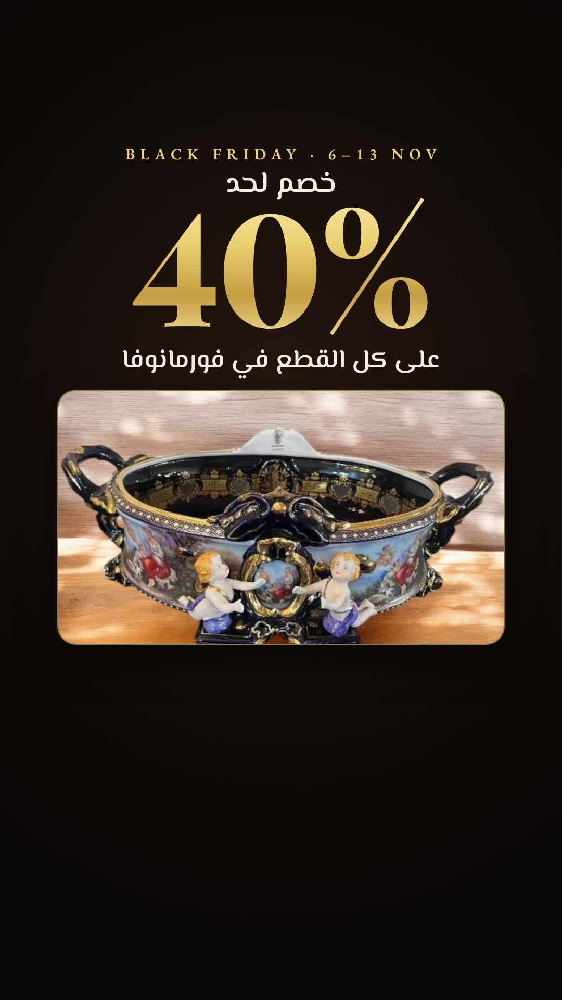</a>
<h4>01 · The Ladder</h4>
<sub>Offer-led film · Egyptian Arabic</sub>
<br><br>
<a href="Content/Ads/2026-11-black-friday/creative-01-ladder/final/formanova-bf-ladder-15s.mp4"><b>Watch / download MP4</b></a>
<br>
<a href="Content/Ads/2026-11-black-friday/creative-01-ladder/script.md">Script</a> · <a href="Content/Ads/2026-11-black-friday/creative-01-ladder/storyboard.md">Storyboard</a>
</td>
<td align="center" width="50%" valign="top">
<a href="Content/Ads/2026-11-black-friday/creative-02-set/final/formanova-bf-set-15s.mp4">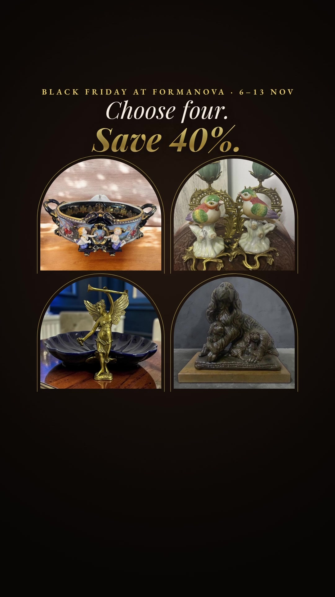</a>
<h4>02 · The 40% Set</h4>
<sub>Premium set and savings · English</sub>
<br><br>
<a href="Content/Ads/2026-11-black-friday/creative-02-set/final/formanova-bf-set-15s.mp4"><b>Watch / download MP4</b></a>
<br>
<a href="Content/Ads/2026-11-black-friday/creative-02-set/script.md">Script</a> · <a href="Content/Ads/2026-11-black-friday/creative-02-set/storyboard.md">Storyboard</a>
</td>
</tr>
</table>

Both films feature the store's most expensive pieces in stock, with their real prices and what 40% off saves. See the [strategy and launch plan](Content/Ads/2026-11-black-friday/strategy.md), the [ad copy](Content/Ads/2026-11-black-friday/ad-copy.md) and the [campaign overview](Content/Ads/2026-11-black-friday/README.md).

### October 2026 sales launch: two 15-second Reels advertisements

<table>
<tr>
<td align="center" width="50%" valign="top">
<a href="Content/Ads/2026-10-sales-launch/creative-01-heritage/final/formanova-heritage-15s.mp4">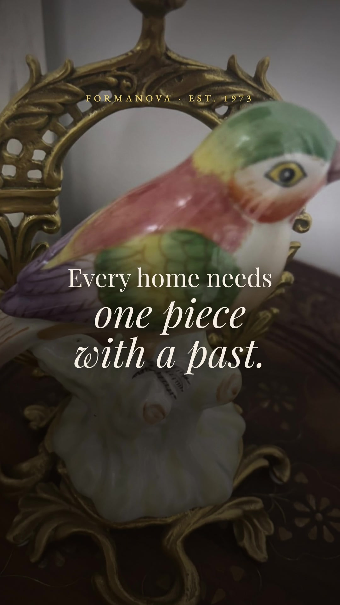</a>
<h4>01 · One Piece With a Past</h4>
<sub>Emotional heritage film · English</sub>
<br><br>
<a href="Content/Ads/2026-10-sales-launch/creative-01-heritage/final/formanova-heritage-15s.mp4"><b>Watch / download MP4</b></a>
<br>
<a href="Content/Ads/2026-10-sales-launch/creative-01-heritage/script.md">Script</a> · <a href="Content/Ads/2026-10-sales-launch/creative-01-heritage/storyboard.md">Storyboard</a>
</td>
<td align="center" width="50%" valign="top">
<a href="Content/Ads/2026-10-sales-launch/creative-02-product/final/formanova-product-15s.mp4">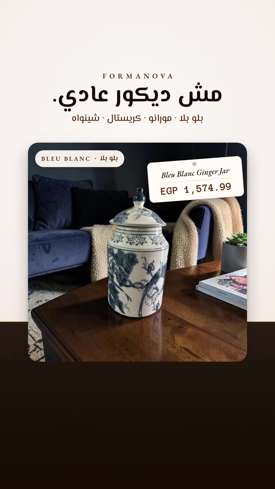</a>
<h4>02 · Not Your Ordinary Decor</h4>
<sub>Direct-response product film · Egyptian Arabic</sub>
<br><br>
<a href="Content/Ads/2026-10-sales-launch/creative-02-product/final/formanova-product-15s.mp4"><b>Watch / download MP4</b></a>
<br>
<a href="Content/Ads/2026-10-sales-launch/creative-02-product/script.md">Script</a> · <a href="Content/Ads/2026-10-sales-launch/creative-02-product/storyboard.md">Storyboard</a>
</td>
</tr>
</table>

Both films are 1080 × 1920, 30 fps, exactly 15.000 s (450 frames), H.264 with AAC audio. They feature only pieces that were in stock at their listed prices on 30 October 2026, and use original music composed for the brand. Read the [strategy](Content/Ads/2026-10-sales-launch/strategy.md), the ready-to-use [ad copy](Content/Ads/2026-10-sales-launch/ad-copy.md) and the [campaign overview](Content/Ads/2026-10-sales-launch/README.md).

## Repository

```
Formanova/
├── Content/
│   ├── Brand/                       Brand guidelines and master assets
│   ├── Ads/
│   │   ├── 2026-11-weekend-40/      40% weekend: ad copy, licensing, manifest, eight films
│   │   ├── 2026-11-bogo-weekend/    Buy 1 Get 1 weekend: strategy, ad copy, licensing, manifest, three films
│   │   ├── 2026-11-black-friday/    Black Friday: strategy, ad copy, licensing, manifest, two films
│   │   └── 2026-10-sales-launch/    October launch: strategy, ad copy, licensing, manifest, two films
│   └── Production/                  Remotion source, score generator, render pipeline
└── .github/                         Content validation (workflow and validator)
```

| Area | Start here |
|---|---|
| Brand identity, colour, type, voice, claims policy | [Content/Brand/brand-guidelines.md](Content/Brand/brand-guidelines.md) |
| Campaigns and deliverables | [40% weekend](Content/Ads/2026-11-weekend-40/README.md) · [Buy 1 Get 1 weekend](Content/Ads/2026-11-bogo-weekend/README.md) · [Black Friday 2026](Content/Ads/2026-11-black-friday/README.md) · [October 2026](Content/Ads/2026-10-sales-launch/README.md) |
| How content is organised | [Content/README.md](Content/README.md) |
| Rebuilding the videos | [Content/Production/README.md](Content/Production/README.md) |

## Preview and reproduce

```bash
cd Content/Production
npm ci
npm run studio      # interactive preview of every film
```

```bash
npm run build       # regenerate the scores, render every film, rebuild the manifests, verify
```

Every push and pull request runs [Validate content](.github/workflows/validate-content.yml). It checks each final video against its declared specification (codec, resolution, frame rate, exact frame count and duration, audio), confirms required documents exist, verifies asset checksums, and builds the production project.

## Adding new content

Each campaign lives in its own `Content/Ads/YYYY-MM-name/` folder with its strategy, copy, licensing record, asset manifest and a `deliverables.json` that CI enforces. New kinds of work, such as photography, website or social, get their own folder under `Content/` when their first real asset arrives. See [Content/README.md](Content/README.md).

---

<sub>Brand marks and product photography © Formanova. The contents of this repository are proprietary and no licence is granted. Typefaces are used under the SIL Open Font License; see <a href="Content/Ads/2026-10-sales-launch/licensing.md">licensing</a> for the full rights record.</sub>
